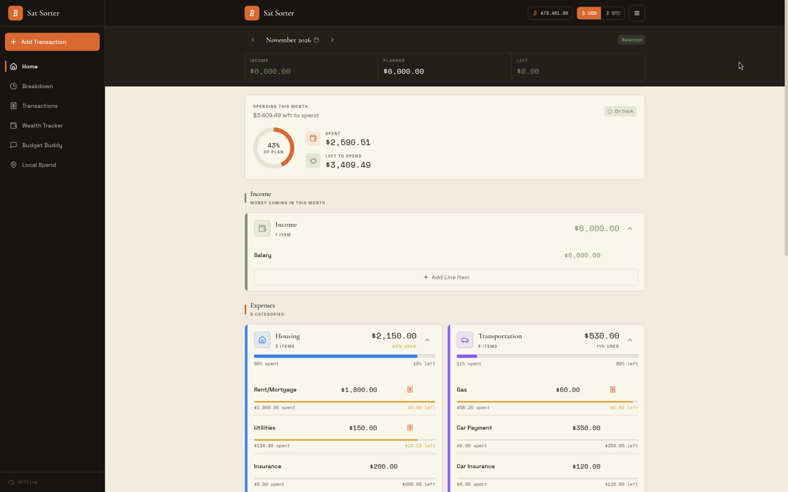
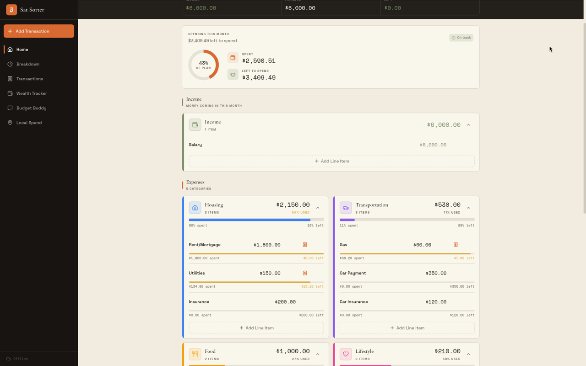
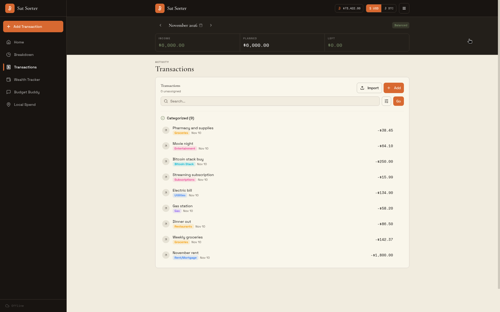
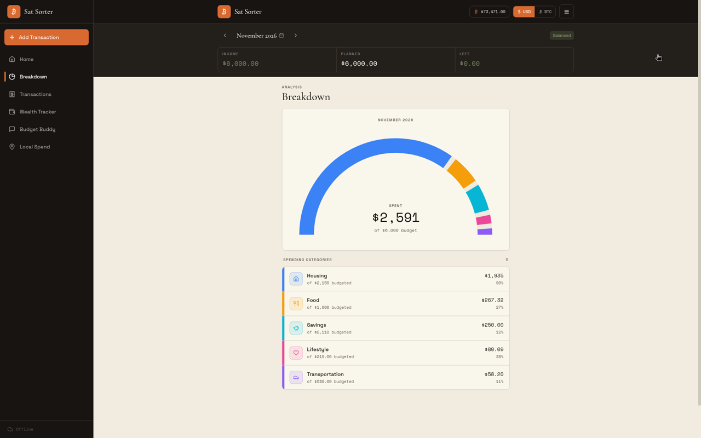

# getumbrel/umbrel-apps pull request

The App Store pull request is https://github.com/getumbrel/umbrel-apps/pull/6342. `submission` in `umbrel-app.yml` points at that URL.

## Title

Add Sat Sorter

## Body

## Type

New app

## App

App ID: sat-sorter
Upstream project: https://github.com/tom-morrow15/sat-sorter
Version: 1.1.0

## Summary

Add Sat Sorter, a zero-based budgeting app for Bitcoiners. The store listing says:

Sat Sorter is a zero-based budgeting app built for Bitcoiners. Plan your month by assigning every dollar or sat to a category, track what you spend as you go, and always know exactly what's left.

Private by design. No accounts, no ads, no tracking, and no company holding your financial data. Your budget is encrypted on your device and syncs between your devices over Nostr, so only you can read it.

Budget together. Share a budget with your partner or household and see each other's changes as they happen.

Free and open source. Unlimited categories, line items and months, with no subscription. Ever.

The web container is `ghcr.io/tom-morrow15/sat-sorter:1.1.0`. Its digest is filled in after the `v1.1.0` tag is published. It listens on port 8080. Umbrel opens the app on port 8580.

The compose file includes a `maple-proxy` sidecar (`ghcr.io/mapleprivacylabs/maple-proxy:0.5.0`, listening on port 8080). The web image proxies same-origin `/maple/` to that container so an optional Maple connection can be used without a separate public proxy. No Maple key is baked into the image. Reviewers will see this service in `docker-compose.yml`; it is not part of the store listing.

There is no app login for Umbrel to display. No host ports are published.

A guest who has not signed in with Nostr keeps one budget on the Umbrel. The web container writes it to `${APP_DATA_DIR}/data/guest-budget.json`. Any browser that opens this Umbrel app without signing in sees that budget, including after its own site data is cleared. If that browser already has a guest budget and the file is empty, the browser copy is saved. If both already have budgets, they are merged and neither copy is thrown away. Two browsers editing at the same time merge on the next save. Signing in with Nostr does not use this file. Upgrading a guest publishes the on-screen budget to Nostr and deletes the Umbrel guest file only after that publish succeeds.

Sat Sorter does not add its own password to this file. Umbrel's app_proxy login is the access control: only someone signed in to the Umbrel can open the app and reach the guest budget. The store process listens on localhost inside the web container.

Gallery images and an icon are omitted. The Umbrel team creates and hosts those assets.

## Verification

Umbrel testing performed:

`npm run lint:apps -- sat-sorter --check-images` in a checkout of getumbrel/umbrel-apps reported no issues. Port 8580 and the app id `sat-sorter` were not used by another package in that checkout.

A local `docker-compose` run on linux/amd64, with Umbrel's imageless `app_proxy` service left out and the web port published only for the test, served the app at `/` and fell back to the same page for `/budget`. `GET /maple/v1/models` reached the `maple-proxy` container, which answered 401 because no Maple API key was configured. This was not run inside umbrelOS.

Environment tested:
- [ ] Umbrel device
- [ ] Local umbrelOS test environment
- [x] Not runtime tested

Architecture tested:
- [x] amd64
- [ ] arm64

The published image index contains linux/amd64 and linux/arm64. Only amd64 was started.

Known lint warnings or caveats:

None from `npm run lint:apps -- sat-sorter --check-images`.

## Notes

No permissions, dependencies, migrations, or default credentials. `defaultUsername` and `defaultPassword` are empty.

`requiresHttps` is set, with `manifestVersion: 2.0`, because budget encryption uses the Web Crypto API. The image also falls back when `crypto.randomUUID` or `navigator.clipboard` is missing.

`app_proxy` sets `APP_HOST` to `sat-sorter_web_1` and `APP_PORT` to `8080`.

The `1.1.0` image digest in `docker-compose.yml` is `DIGEST_PENDING_AFTER_TAG` until the `v1.1.0` tag is published. Do not copy that line into getumbrel/umbrel-apps until the real multi-arch digest replaces it. The volume is `${APP_DATA_DIR}/data:/data` and the web service runs as uid 1000 so it can write the guest file.

Logo source, for the Umbrel team to redraw: https://github.com/tom-morrow15/sat-sorter/blob/main/public/icons/icon.svg and https://github.com/tom-morrow15/sat-sorter/blob/main/public/icons/icon-512.png

Do not commit gallery images or an icon. The Umbrel team adds those.

## Screenshots

